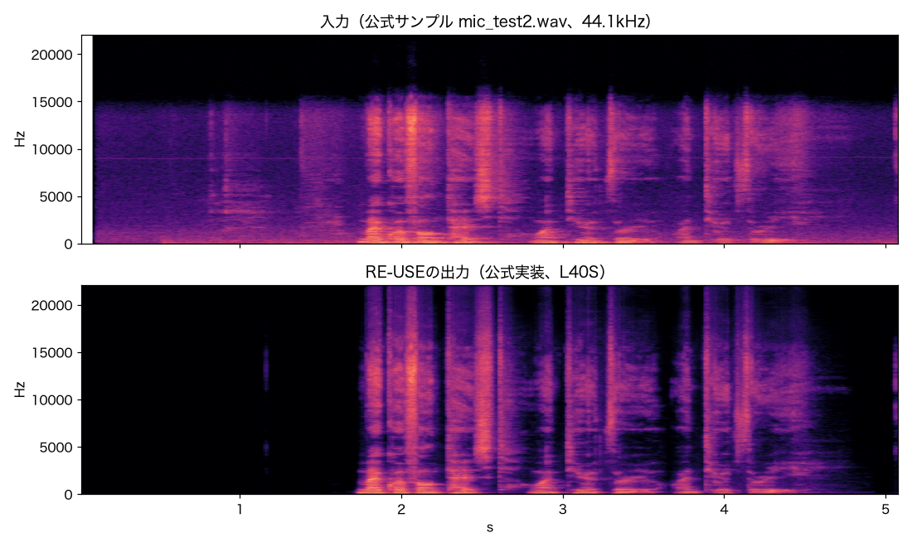

# NVIDIAの音声強調モデル「NemotronLabs RE-USE」を公式実装で動かしてみた（9.6Mパラメータで商用利用可）

こんにちは。製造ビジネステクノロジー部の中村（[@nokomoro3](https://linktr.ee/nokomoro3)）です。

2026年10月22日に、NVIDIAから音声強調モデル「NVIDIA NemotronLabs RE-USE」がHugging Faceで公開されました。

- [nvidia/NVIDIA-NemotronLabs-RE-USE（Hugging Face）](https://huggingface.co/nvidia/NVIDIA-NemotronLabs-RE-USE)

雑音や残響、帯域制限などで劣化した音声を、1つのモデルで復元するモデルです。
パラメータ数は9.6Mと小さく、ライセンスはOpenMDW-1.1で商用利用もできます。

RE-USEには、先に研究用として公開された非商用版や、リアルタイム処理向けのモデルもあり、名前が似ていて関係がわかりにくくなっています。
そこで本記事では、まずRE-USEのモデル群を整理し、そのうえで商用利用できるNemotronLabs版をNVIDIA L40Sで公式実装のまま動かし、各サンプリングレートでの速度とメモリ使用量を測りました。

## 結論

- モデル群
  - RE-USEには、非商用の `nvidia/RE-USE`、商用利用できる `NVIDIA-NemotronLabs-RE-USE` とその笑い声保持版、非商用でストリーミング向けの `Real-time_RE-USE` がある
  - `nvidia/RE-USE` とNemotronLabs版は構造と設定が同じだが、重みは別物（ハッシュが異なる）
- 動作確認
  - L40Sで公式の推論スクリプトがそのまま動いた（公式の動作確認環境はA100）
  - 環境構築では、torchとmamba_ssmのバージョンの組み合わせと、Pythonのヘッダファイルに注意が必要
- 処理速度と使用メモリ
  - 5.1秒の音声の処理時間は、16kHzで0.15秒（RTF 0.030）、48kHzで0.46秒（RTF 0.090）
  - 処理時間とGPUメモリはサンプリングレートにほぼ比例し、一括処理のGPUメモリは音声の長さにもほぼ比例する
  - 30秒の16kHz音声では、一括処理でGPUメモリを5.3GiB使うのに対し、チャンク処理では0.9GiBで済んだ
- 注意点
  - 今回公開された `NVIDIA-NemotronLabs-RE-USE` は双方向Mambaのため、音声全体がそろってから処理するモデルで、ストリーミングには使えない
  - ストリーミング処理には、別モデルの `Real-time_RE-USE` を使う必要がある（ただし非商用ライセンス）
  - 学習データに日本語は含まれていない

## 検証用コード

検証に使用したスクリプトは以下のリポジトリにあります。

<!-- TODO: 公開時にリポジトリのURLを記載する -->

## RE-USEとは

### モデルの特徴

RE-USEは、NVIDIAが開発したユニバーサル音声強調（Universal Speech Enhancement）のモデルです。
従来の音声強調モデルは、雑音除去、残響除去、帯域拡張のように劣化の種類ごとに作られることが多くありました。
これに対してユニバーサル音声強調は、さまざまな劣化を1つのモデルでまとめて復元することを目指しています。

モデルカードに記載されている特徴は以下のとおりです。

- 対応する劣化：加法性雑音、残響、クリッピング、帯域制限、コーデックによる劣化、パケットロス、低品質なマイク
- 対応するサンプリングレート：8、16、22.05、24、32、44.1、48kHz（入力と同じレートで出力する）
- 言語：言語に依存しない性能をうたっている（学習データは英語、ドイツ語、スペイン語、フランス語、中国語）
- 重なった発話：主話者を残し、ほかの話者を抑えるように学習されている

アーキテクチャは、畳み込みのエンコーダとデコーダの間に、時間方向のMambaと周波数方向のMambaを1組としたブロックを、30段重ねた構成です。

<!-- TODO: モデルアーキテクチャの図 -->

入力はSTFT（短時間フーリエ変換）の振幅スペクトルと位相スペクトルで、モデルは強調後の振幅と位相の両方を推定し、逆変換（ISTFT）で波形に戻します。
STFTの窓長とホップ幅（シフト長）は8kHzを基準にサンプリングレートに比例してサンプル数を増やすため、どのサンプリングレートでも1秒あたりのフレーム数は200で一定になります。
STFTでは周波数方向を一定の幅で区切り、区切った一つひとつを周波数ビンと呼びます。
RE-USEでは周波数ビンの幅が25Hzで、こちらもサンプリングレートによらず一定です。
そのため、サンプリングレートを上げると扱う周波数の上限が上がり、周波数ビンの数が増えます（16kHzで321、48kHzで961）。

詳細は以下の2本の論文を参照ください。

- [Rethinking Training Targets, Architectures and Data Quality for Universal Speech Enhancement（NeurIPS 2026）](https://arxiv.org/abs/2603.02641)
- [One Model, Many Latencies: Universal Speech Enhancement for Diverse Real-Time Applications（IEEE SLT 2026）](http://arxiv.org/abs/2606.25621)

### RE-USEのモデル群

Hugging Faceには、RE-USEの名前を持つモデルが4つあります。

| リポジトリ | 公開日 | パラメータ数 | ライセンス | 用途 |
| --- | --- | ---: | --- | --- |
| [nvidia/NVIDIA-NemotronLabs-RE-USE](https://huggingface.co/nvidia/NVIDIA-NemotronLabs-RE-USE) | 2026年10月22日 | 9.6M | OpenMDW-1.1（商用利用可） | 本記事の対象 |
| [nvidia/NVIDIA-NemotronLabs-RE-USE-laughter](https://huggingface.co/nvidia/NVIDIA-NemotronLabs-RE-USE-laughter) | 2026年10月22日 | 9.6M | OpenMDW-1.1（商用利用可） | 笑い声を残したい場合 |
| [nvidia/Real-time_RE-USE](https://huggingface.co/nvidia/Real-time_RE-USE) | 2026年4月14日 | 3.7M | NVIDIA One-Way Noncommercial（非商用） | ストリーミング処理 |
| [nvidia/RE-USE](https://huggingface.co/nvidia/RE-USE) | 2026年3月18日 | 9.6M | NVIDIA One-Way Noncommercial（非商用） | 研究開発用 |

`nvidia/RE-USE` のモデルカードには、商用利用する場合はNemotronLabs版を使うよう案内があります。
笑い声保持版は、学習データに笑い声などの発声を集めたVocalSoundを加えたモデルで、構造はNemotronLabs版と同じです。

`Real-time_RE-USE` は、ほかの3つとは別の構造を持つストリーミング向けのモデルです。
使う層の数（3〜12）と先読みするフレーム数（0〜2）の組み合わせで、1つのモデルを30通りの遅延設定で動かせます。
1フレームずつ入力して1フレームずつ出力する推論コードも付属しています。

`nvidia/RE-USE` とNemotronLabs版のリポジトリを比べると、`config.json` は同一でした。
モデルの定義（`models/` 以下）とユーティリティはライセンス表記のコメントだけが異なり、推論スクリプトの差分も、ライセンス表記、読み込むリポジトリ名、使われていない引数の削除だけでした。笑い声保持版も、`config.json` の値はNemotronLabs版と同じです（`cfg` というキーの下に入れ子になっている点だけが違います）。
なお、`Real-time_RE-USE` は構造が別のモデルなので、この比較には含めていません。

一方で、重みファイルのSHA-256は3つとも異なります。
構造と設定は同じでも、重みはそれぞれ別のものです。

| リポジトリ | `model.safetensors` のSHA-256（先頭8桁） |
| --- | --- |
| `nvidia/RE-USE` | `87a4a970` |
| `nvidia/NVIDIA-NemotronLabs-RE-USE` | `06badaf4` |
| `nvidia/NVIDIA-NemotronLabs-RE-USE-laughter` | `35c2a4e2` |

重みが違う理由は、モデルカードに記載された学習データから推測できます。
`nvidia/RE-USE` にあってNemotronLabs版にないデータセットは、以下の4つです。

| データセット | 用途 | ライセンス |
| --- | --- | --- |
| [EARS](https://github.com/facebookresearch/ears_dataset)（約100時間） | 音声 | CC-NC 4.0 |
| [WHAM! Noise](http://wham.whisper.ai/)（約80時間） | 雑音 | CC BY-NC 4.0 |
| [FSD50K](https://zenodo.org/records/4060432)（約100時間） | 音声以外の音 | 全体はCC BYだが、CC BY-NCのクリップを含む |
| [Free Music Archive](https://github.com/mdeff/fma)（約200時間） | 音楽 | 楽曲ごとにアーティストが選んだライセンス（研究目的のデータセット） |

どれも、商用利用に何らかの制限があるデータセットです。
代わりにNemotronLabs版では、NVIDIAの社内データセット（Riva Speakers）が追加されています。
NVIDIAは理由を明記していませんが、商用利用に制限のあるデータを除き、社内データで補って学習し直したものがNemotronLabs版だと考えられます。
同じ4つのデータセットを含む `Real-time_RE-USE` が非商用のままであることとも合います。

コミュニティによるGGUF版（`audio-cpp/RE-USE-GGUF`）やMLX版（`appautomaton/re-use-semamba-mlx`）も公開されていますが、本記事の執筆時点では、どちらも非商用の `nvidia/RE-USE` の重みから変換されています。
商用で使う場合は、変換元のリポジトリを確認しておく必要があります。

### モデルカードのベンチマーク

モデルカードには、URGENT 2025 Challengeのnon-blindテストセットで、ほかのオープンなユニバーサル音声強調モデルと比べた結果が掲載されています。
以下は全体セットの結果で、数値はいずれもNVIDIAによる評価です。

| モデル | パラメータ数 | DNSMOS | NISQA | UTMOS | PESQ | STOI | SBERT | LPS | Spk | CAcc |
| --- | ---: | ---: | ---: | ---: | ---: | ---: | ---: | ---: | ---: | ---: |
| 劣化音声（処理なし） | - | 1.84 | 1.69 | 1.56 | 1.34 | 0.50 | 0.74 | 0.61 | 0.73 | 81.29 |
| Sidon | 250M | **3.34** | 3.87 | **3.21** | 1.73 | 0.62 | 0.85 | 0.80 | 0.74 | 84.68 |
| UniPASE | 500M | 3.21 | 4.03 | 2.96 | 2.17 | 0.76 | **0.89** | 0.85 | 0.81 | 87.28 |
| NemotronLabs RE-USE | 9.6M | 3.29 | **4.33** | 2.94 | **2.57** | **0.78** | 0.88 | **0.85** | **0.86** | **89.17** |

指標は大きく3種類に分かれます。

- **音質の推定値**：DNSMOS、NISQA、UTMOSは、聞いた印象の良さを推定するモデルによるスコア
- **元音声との一致度**：PESQ、STOIは、劣化前のきれいな音声とどれだけ近いかを測る
- **内容と話者の保存**：SBERT（SpeechBERTScore）、LPS（音素の一致度）、Spk（話者の類似度）、CAcc（OWSM v3.1による音声認識の文字正解率）

RE-USEは、音質の推定値ではSidonと同程度ですが、元音声との一致度と、内容や話者の保存では最も良い結果です。
パラメータ数がSidonの約26分の1、UniPASEの約52分の1であることを考えると、小さなモデルで忠実さを保てている点が特徴だと言えそうです。

モデルカードには16kHz、44.1kHz、48kHzのサブセットごとの結果もあり、44.1kHzと48kHzのサブセットでは比較対象（Resemble Enhance、ClearVoice）をすべての指標で上回っています。

## 実行環境

それでは実行環境を整えていきます。

### Brevのインスタンス

実行環境には、前回の日本語ASRの比較記事と同じく、NVIDIA BrevでL40Sを1基持つインスタンス（`l40s-48gb.1x`）を使いました。

https://dev.classmethod.jp/articles/japanese-asr-l40s-fleurs-benchmark/

以下が起動するコマンドです。

```bash
brev create cm-nakamura-re-use --type l40s-48gb.1x
```

モデルカードで動作確認されているGPUはA100（Ampere世代）ですが、L40S（Ada Lovelace世代）でも問題なく動きました。

### ソフトウェアのバージョン

各ソフトウェアのバージョンは以下の通りです。

| 項目 | バージョン |
| --- | --- |
| GPU | NVIDIA L40S（48GB） |
| NVIDIAドライバ | 565.57.01 |
| Python | 3.10（uvが管理するPython） |
| PyTorch | 2.6.0+cu124 |
| mamba_ssm | 2.2.4 |
| causal-conv1d | 1.5.0.post8 |
| モデルのrevision | `31f82f2efad1095034492f236e8dac9239ba713b` |

モデルカードでは、Mambaの環境構築にSEMambaのリポジトリで配布されているDockerイメージが案内されています。
今回は、mamba_ssmとcausal-conv1dの公式リリースにあるビルド済みのwheelを使い、uvの仮想環境に直接インストールしました。

### セットアップコマンド

前述のソフトウェアのバージョンをセットアップするコマンドは以下です。

```bash
uv venv --managed-python --python 3.10 work/.venv-gpu
source work/.venv-gpu/bin/activate

# 分割してpip install、後段で torch が新しい版に上がってしまうため一括インストール
uv pip install \
  --extra-index-url https://download.pytorch.org/whl/cu124 \
  --index-strategy unsafe-best-match \
  "torch==2.6.0+cu124" "torchaudio==2.6.0+cu124" \
  "causal_conv1d @ https://github.com/Dao-AILab/causal-conv1d/releases/download/v1.5.0.post8/causal_conv1d-1.5.0.post8+cu12torch2.6cxx11abiFALSE-cp310-cp310-linux_x86_64.whl" \
  "mamba_ssm @ https://github.com/state-spaces/mamba/releases/download/v2.2.4/mamba_ssm-2.2.4+cu12torch2.6cxx11abiFALSE-cp310-cp310-linux_x86_64.whl" \
  einops safetensors soundfile numpy pyyaml librosa resampy "huggingface_hub<1" "transformers<5"
```

最新のmamba_ssm 2.3.2.post1はtriton 3.5以上を要求し、torch 2.6が要求するtriton 3.2と両立しません。
そのためtorch 2.6向けのwheelが配布されているmamba_ssm 2.2.4とcausal-conv1d 1.5.0.post8に下げました。

また、mamba_ssmを読み込むと、tritonが実行時に小さなC拡張をビルドします。
Brevのシステムにデフォルトで入っているPython 3.10には開発用ヘッダ（`Python.h`）がなく、このビルドが失敗するため、ヘッダを同梱しているuv管理のPythonで仮想環境を作り直すことで動作することを確認しています。

### モデルのダウンロード

またRE-USEモデルはrevisionを固定してダウンロードしました。

```python
from huggingface_hub import snapshot_download

snapshot_download(
    "nvidia/NVIDIA-NemotronLabs-RE-USE",
    revision="31f82f2efad1095034492f236e8dac9239ba713b",
    local_dir="models/original",
)
```

## 推論の実行

### 公式スクリプトでの推論

リポジトリには、推論用のシェルスクリプトが2つ含まれています。

- `inference.sh`：`noisy_audio/` の音声を1ファイルずつまとめて処理し、`enhanced_audio/` にFLACで保存する
- `inference_chunk.sh`：`long_noisy_audio/` の音声を5秒ずつ半分重ねて区切って処理し、結果をHann窓で重ね合わせる

`inference_chunk.sh` は長い音声向けで、モデルカードでは30秒を超える音声やGPUメモリが足りない場合にこちらを使うよう案内されています。
サンプル音声は短いものが多いため、今回は `inference.sh` を実行しています。

```bash
cd models/original
sh inference.sh
```

```text
Initializing Inference Process...
./noisy_audio/mic_test2.wav
```

### 処理結果

付属のサンプル（44.1kHz、5.1秒）について、処理前後のスペクトログラムを並べました。



発話が始まる前（0〜1.7秒）の雑音と、発話の間の背景雑音がほぼ消えています。
入力に見える9kHz付近の横線（定常的なハム音）もなくなっていることがわかります。

もう1つ目に付くのは、高い周波数の成分です。
入力は約15kHzより上が切れていますが、出力には22kHz付近まで成分があります。
帯域拡張のオプション（`--BWE`）を指定していなくても、帯域が制限された入力に対しては、失われた高域を補って出力するようです。

### 動作オプション

<!-- TODO: 引数オプションをここで書く -->

## 速度とメモリ使用量の測定

### 測定方法

速度を測るため、公式スクリプトと同じ処理を繰り返し行うスクリプト `TODO: スクリプト名` を用意しました。

<!-- TODO: GitHub公開したらスクリプトのURL -->

公式の `inference.py` との違いは、出力を16bitのFLACではなく32bit浮動小数点のWAVで保存する点と、同じ入力を繰り返し処理して時間を測る点だけです。
公式スクリプトの出力とは、コサイン類似度0.9999999で一致することを確認しています（差はFLACの量子化誤差程度）。

測定条件は以下のとおりです。

- 入力：付属のサンプルを、soxrで各サンプリングレートにリサンプルした音声（5.1秒）
- 計測範囲：STFTからモデルの推論、ISTFTまで（モデルのロードとファイルの読み書きは含まない）
- 回数：同じ入力を6回処理し、初回を除いた5回の中央値
- メモリ：PyTorchのアロケータが確保した最大量（`torch.cuda.max_memory_allocated`）
- 精度：FP32（TF32は無効）

RTF（Real Time Factor）は、処理時間を音声の長さで割った値です。
1より小さければ、音声の長さより短い時間で処理できます。

### サンプリングレートごとの結果

| サンプリングレート | 処理時間 | RTF | GPUメモリ |
| --- | ---: | ---: | ---: |
| 8kHz | 0.082秒 | 0.016 | 0.49GiB |
| 16kHz | 0.153秒 | 0.030 | 0.92GiB |
| 22.05kHz | 0.230秒 | 0.045 | 1.25GiB |
| 24kHz | 0.227秒 | 0.045 | 1.35GiB |
| 32kHz | 0.309秒 | 0.061 | 1.78GiB |
| 44.1kHz | 0.471秒 | 0.092 | 2.45GiB |
| 48kHz | 0.462秒 | 0.091 | 2.65GiB |

処理時間とGPUメモリは、どちらもサンプリングレートにほぼ比例しています。
前述のとおり、1秒あたりのフレーム数はサンプリングレートによらず一定で、周波数ビンの数だけがサンプリングレートに比例して増えるためです。
48kHzでもRTFは0.09で、音声の長さの10分の1以下の時間で処理できています。

TF32を有効にした場合も測りましたが、処理時間の短縮は5〜18%にとどまりました。

### 長い音声での一括処理とチャンク処理

16kHzのサンプルを6回つないだ30.6秒の音声で、一括処理とチャンク処理（5秒ずつ半分重ねる、公式スクリプトの既定値）を比べました。

| 処理方法 | 処理時間 | RTF | GPUメモリ |
| --- | ---: | ---: | ---: |
| 一括処理（`inference.py` 相当） | 1.15秒 | 0.038 | 5.28GiB |
| チャンク処理（`inference_chunk.py` 相当） | 1.95秒 | 0.064 | 0.91GiB |

一括処理のGPUメモリは、5.1秒のときの0.92GiBから5.28GiBに増えており、音声の長さにほぼ比例しています。
チャンク処理は区間を半分ずつ重ねるため、処理する音声の量が約2倍になり、処理時間も約1.7倍になりました。
一方で、GPUメモリは音声の長さによらず5秒ぶんで済みます。
数分を超える音声を扱う場合や、GPUメモリが小さい環境では、チャンク処理を使うことでGPUメモリ消費量を抑えられそうです。

## 使用上の注意点

まず、NemotronLabs版はストリーミング処理に使えません。
時間方向のMambaが双方向で、未来側からも音声を参照するため、音声全体がそろわないと出力を確定できない構造です。
チャンク処理を使っても、5秒の区間がそろうまで待つことになります。
ストリーミング向けには `Real-time_RE-USE` がありますが、こちらは非商用ライセンスとなっています。

次に、重なった発話の扱いです。
主話者を残してほかの話者を抑えるように学習されているため、複数人が話す会議の録音などでは、主話者以外の声が弱まる可能性があります。
話者分離や議事録作成の前処理に使う場合は、事前に確認が必要です。

最後に、日本語は学習データに含まれていません。言語に依存しない性能をうたっていますが、日本語での効果は自分で確かめる必要があります。

## まとめ

NVIDIAの音声強調モデルNemotronLabs RE-USEについて、モデル群を整理し、公式実装をL40Sで動かしました。
9.6Mパラメータと小さく、48kHzの音声でもRTF 0.09で処理でき、商用利用もできるため、録音の品質改善や音声処理の前段に組み込みやすいモデルです。
モデル群の中では、`nvidia/RE-USE` とNemotronLabs版の重みが別物である点と、ストリーミング向けのモデルが非商用である点に注意が必要です。

今回は付属のサンプル音声でしか試していません。
次回以降は、MLXに変換してMacで動かす方法と、日本語音声認識の前処理としての効果を確かめる予定です。

## 参考リンク

- [nvidia/NVIDIA-NemotronLabs-RE-USE（Hugging Face）](https://huggingface.co/nvidia/NVIDIA-NemotronLabs-RE-USE)
- [nvidia/NVIDIA-NemotronLabs-RE-USE-laughter（Hugging Face）](https://huggingface.co/nvidia/NVIDIA-NemotronLabs-RE-USE-laughter)
- [nvidia/RE-USE（Hugging Face）](https://huggingface.co/nvidia/RE-USE)
- [nvidia/Real-time_RE-USE（Hugging Face）](https://huggingface.co/nvidia/Real-time_RE-USE)
- [Rethinking Training Targets, Architectures and Data Quality for Universal Speech Enhancement（arXiv）](https://arxiv.org/abs/2603.02641)
- [One Model, Many Latencies: Universal Speech Enhancement for Diverse Real-Time Applications（arXiv）](http://arxiv.org/abs/2606.25621)
- [state-spaces/mamba（GitHub）](https://github.com/state-spaces/mamba)
- [前回の記事：NVIDIA L40Sで日本語対応ASRモデルを比較してみた](https://dev.classmethod.jp/articles/japanese-asr-l40s-fleurs-benchmark/)
